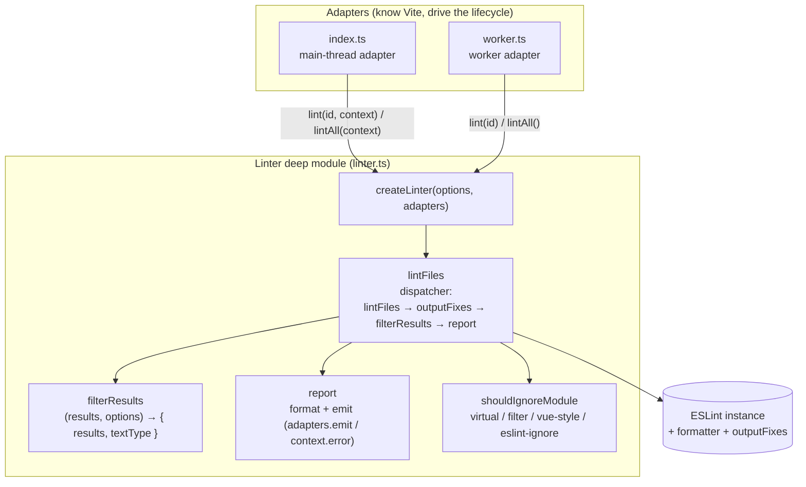

# Contributing to vite-plugin-eslint2

This guide covers the architecture and how to get a local environment running.

## Prerequisites

- Node.js `^22.22.2 || >=24.15.0`. The toolchain needs it; the published package still supports `node>=18`.
- pnpm 12, enforced by `only-allow`.
- ESLint v7 to v10 to run the example.

## Local development

```sh
# 1. Clone and install
git clone https://github.com/ModyQyW/vite-plugin-eslint2.git
cd vite-plugin-eslint2
pnpm install

# 2. Keep the core package building (writes dist/ on every change)
pnpm dev

# 3. In another terminal, run an example against that build
pnpm -C examples/react-ts dev
# or: pnpm -C examples/react-ts build
```

The example links to the core package through `workspace:*` and resolves it through `exports`, which points at `dist/`. Without a build, the example fails with `TS2307: Cannot find module 'vite-plugin-eslint2'`. Keep `pnpm dev` running while you iterate.

### Scripts

| Command | Purpose |
| --- | --- |
| `pnpm dev` | Watch-build all packages |
| `pnpm build` | One-shot build (tsdown → `dist/`) |
| `pnpm typecheck` | `tsc --noEmit`, then the same inside `docs/` |
| `pnpm test` | Run vitest once |
| `pnpm test:coverage` | Same, with coverage |
| `pnpm fix` | Apply Biome fixes through ultracite |
| `pnpm check` | Report Biome findings without fixing |
| `pnpm docs:dev` | Run the Rspress docs site locally |
| `pnpm docs:build` | Build the docs site |
| `pnpm docs:preview` | Serve the built docs site |

### Verifying a change

Run the same checks CI runs:

```sh
pnpm fix && pnpm typecheck && pnpm test && pnpm build
```

Then build the example, which is the only step that exercises the plugin end to end:

```sh
pnpm -r --filter=./examples/* run build
```

## Architecture

The plugin runs ESLint on the modules Vite processes. All coordination lives in one deep module, `Linter`, and two thin adapters drive it depending on `lintInWorker`.



### Module responsibilities

| Module | Role | Knows about |
| --- | --- | --- |
| `index.ts` | Main-thread adapter. Holds the worker, the linter, the logger, the dev server and the overlay handshake state. Wires `apply`, `configResolved`, `configureServer`, `buildStart`, `resolveId`, `load`, `transformIndexHtml`, `transform` and `buildEnd`. | Vite plugin lifecycle, worker lifecycle |
| `worker.ts` | Worker adapter. Forwards `parentPort` messages to `linter.lint(id)`. Around 40 lines. | Node `worker_threads` only |
| `linter.ts` | The deep module. Owns `createLinter`, `filterResults`, `buildOverlayPayload`, `OverlayManager` and `shouldIgnoreModule`, the last three exported for testing. | ESLint only — no Vite server or worker concepts |
| `utils.ts` | `getOptions`, which turns user options into the fully-defaulted shape. | The options shape only |

### Key design rules

- **`Linter` is the only place that knows how to run one lint pass.** Adapters turn the outside world (Vite hooks, worker messages) into `lint(id, context)` and `lintAll(context)` calls; they never assemble `eslintInstance + formatter + outputFixes` themselves.
- **`context` is a per-call argument, never a captured closure.** Vite runs `transform` hooks concurrently, so a shared context would be overwritten between lints and emit to the wrong module. The worker passes nothing and gets stdout output.
- **`adapters` is the seam between the two adapters.** `createLinter(options, adapters)` takes an optional `emit` (how to write formatted text) and an optional `onOverlayPayload` (where structured overlay data goes).
- **`filterResults` does no I/O.** `(results, options) → { results, textType }`, with no ESLint instance involved, which is why it carries the filter and severity tests. The emit step stays private and is exercised through `createLinter`.
- **Plugin options and ESLint options share one namespace.** `ESLintPluginOptions extends ESLint.ESLint.Options`. `getESLintConstructorOptions` (`linter.ts`) splits them by exclusion using `PLUGIN_OPTION_KEYS`. A key that is not in that list is forwarded to the ESLint constructor, so it can collide with an ESLint option name. `cache` works today because ESLint uses the same name for the same thing.

### Adding a plugin option

1. Add the field to `ESLintPluginOptions` / `ESLintPluginUserOptions` in `types.ts`, with bilingual JSDoc like the neighbouring fields.
2. Give it a default in `getOptions` (`utils.ts`).
3. **Append the name to `PLUGIN_OPTION_KEYS` (`constants.ts`).** Miss this and the option is silently passed to ESLint.
4. If it changes filtering or the severity decision, update `filterResults` and add a case to `linter.test.ts`.

### Custom overlay handshake

Under `serve` with `customOverlay` on, `index.ts` injects the runtime through `transformIndexHtml` and then waits for a `WS_RUNTIME_LOADED_EVENT` ping over Vite's WebSocket before pushing `WS_OVERLAY_EVENT` payloads. Payloads that arrive earlier sit in `pendingPayload` and are replayed on the ping. No ping within `OVERLAY_DEGRADE_GRACE_MS` (2000 ms) means a DOM-less environment: warn once, stop pushing, keep printing to the terminal.

The runtime is pre-built to `dist/client-runtime.js` and inlined with `readFileSync`, so the plugin serves no extra file. `pnpm build` has to run before `customOverlay` works from source.

## Committing

- There is no git hook. CI runs `pnpm check`, `pnpm build`, the example builds, `pnpm test` and `pnpm typecheck` on every push and pull request; `.vscode/settings.json` formats on save.
- `pnpm release` runs `lerna version` on `main` after `preversion` (`fix`, `typecheck`, `test`).
- Commit messages follow [Conventional Commits](https://www.conventionalcommits.org/) (`feat:`, `fix:`, `refactor:`, `docs:`, `chore:`).
