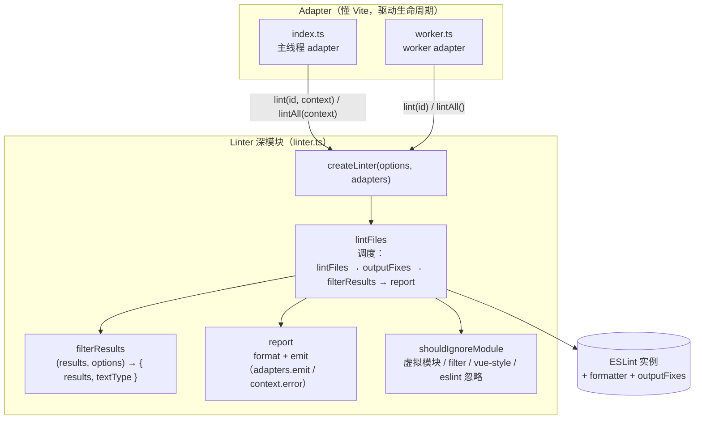

# 贡献 vite-plugin-eslint2

这里讲项目架构，以及怎么把本地环境跑起来。

## 前置条件

- Node.js `^22.22.2 || >=24.15.0`。工具链需要这个版本，发布的包仍然支持 `node>=18`。
- pnpm 12，由 `only-allow` 强制。
- 运行示例需要 ESLint v7 到 v10。

## 本地开发

```sh
# 1. 克隆并安装
git clone https://github.com/ModyQyW/vite-plugin-eslint2.git
cd vite-plugin-eslint2
pnpm install

# 2. 让核心包一直处在构建状态（改动后写入 dist/）
pnpm dev

# 3. 另开一个终端，用这份产物跑示例
pnpm -C examples/react-ts dev
# 或者：pnpm -C examples/react-ts build
```

示例通过 `workspace:*` 链接核心包，走的是 `exports` 指向的 `dist/`。没有构建产物时会报 `TS2307: Cannot find module 'vite-plugin-eslint2'`。改代码期间让 `pnpm dev` 一直跑着。

### 脚本

| 命令 | 用途 |
| --- | --- |
| `pnpm dev` | watch 构建所有包 |
| `pnpm build` | 一次性构建（tsdown → `dist/`） |
| `pnpm typecheck` | 先 `tsc --noEmit`，再在 `docs/` 里跑一遍 |
| `pnpm test` | 跑一次 vitest |
| `pnpm test:coverage` | 同上，带覆盖率 |
| `pnpm fix` | 经 ultracite 应用 Biome 修复 |
| `pnpm check` | 只报告 Biome 问题，不改文件 |
| `pnpm docs:dev` | 本地跑 Rspress 文档站点 |
| `pnpm docs:build` | 构建文档站点 |
| `pnpm docs:preview` | 预览构建好的文档站点 |

### 验证改动

跑一遍和 CI 相同的检查：

```sh
pnpm fix && pnpm typecheck && pnpm test && pnpm build
```

然后构建示例，这是唯一能把插件从头到尾跑一遍的步骤：

```sh
pnpm -r --filter=./examples/* run build
```

## 架构

插件对 Vite 处理过的模块跑 ESLint。所有调度都在 `Linter` 这一个深模块里，由两个轻量 adapter 按 `lintInWorker` 决定谁来驱动。



### 模块职责

| 模块 | 角色 | 知道什么 |
| --- | --- | --- |
| `index.ts` | 主线程 adapter。持有 worker、linter、logger、dev server 和遮罩握手状态，接 `apply`、`configResolved`、`configureServer`、`buildStart`、`resolveId`、`load`、`transformIndexHtml`、`transform` 和 `buildEnd`。 | Vite 插件生命周期、worker 生命周期 |
| `worker.ts` | worker adapter。把 `parentPort` 的消息转给 `linter.lint(id)`，大约 40 行。 | 只有 Node 的 `worker_threads` |
| `linter.ts` | 深模块。包含 `createLinter`、`filterResults`、`buildOverlayPayload`、`OverlayManager` 和 `shouldIgnoreModule`，后三个导出给测试用。 | 只有 ESLint，不碰 Vite server，也不碰 worker |
| `utils.ts` | `getOptions`，把用户选项补成带默认值的完整形状。 | 只有选项形状 |

### 关键设计规则

- **只有 `Linter` 知道怎么跑一次校验。** Adapter 把外面的东西（Vite 钩子、worker 消息）翻译成 `lint(id, context)` 和 `lintAll(context)`，自己从不拼 `eslintInstance + formatter + outputFixes`。
- **`context` 每次调用都传，不用闭包捕获。** Vite 的 `transform` 钩子是并发跑的，共享一个 context 会被覆盖，结果报到别的模块上。worker 什么都不传，直接打到 stdout。
- **`adapters` 是两个 adapter 之间的接缝。** `createLinter(options, adapters)` 收可选的 `emit`（怎么写出格式化文本）和 `onOverlayPayload`（结构化遮罩数据往哪送）。
- **`filterResults` 不做 I/O。** `(results, options) → { results, textType }`，不碰 ESLint 实例，所以过滤和严重级别的测试都放在它身上。输出那一步保持私有，通过 `createLinter` 验证。
- **插件选项和 ESLint 选项共用一个命名空间。** `ESLintPluginOptions extends ESLint.ESLint.Options`。`linter.ts` 里的 `getESLintConstructorOptions` 按 `PLUGIN_OPTION_KEYS` 排除，剩下的都转给 ESLint 构造器，所以名字可能和 ESLint 撞车。`cache` 现在能用，是因为 ESLint 有同名同义的选项。

### 新增插件选项

1. 在 `types.ts` 的 `ESLintPluginOptions` / `ESLintPluginUserOptions` 里加字段，双语 JSDoc 照旁边字段的写法。
2. 在 `getOptions`（`utils.ts`）里给默认值。
3. **把名字加进 `PLUGIN_OPTION_KEYS`（`constants.ts`）。** 漏了这一步，选项会被悄悄传给 ESLint。
4. 如果影响过滤或严重级别判断，改 `filterResults`，并在 `linter.test.ts` 里加用例。

### 遮罩握手

`serve` 下开着 `customOverlay` 时，`index.ts` 通过 `transformIndexHtml` 注入运行时，然后等 Vite WebSocket 上来的 `WS_RUNTIME_LOADED_EVENT`，收到之后才推 `WS_OVERLAY_EVENT` 的数据。早到的数据先存在 `pendingPayload`，收到 ping 再补发。`OVERLAY_DEGRADE_GRACE_MS`（2000 毫秒）内没有 ping，说明环境里没有 DOM：警告一次，停止推送，继续往终端输出。

运行时被预先打包成 `dist/client-runtime.js`，用 `readFileSync` 内联进来，插件不需要额外提供文件。从源码跑的话，得先执行 `pnpm build`，`customOverlay` 才能用。

## 提交

- 没有 git 钩子。每次 push 和 PR 都由 CI 跑 `pnpm check`、`pnpm build`、示例构建、`pnpm test` 和 `pnpm typecheck`；`.vscode/settings.json` 在保存时格式化。
- `pnpm release` 在 `main` 上跑 `lerna version`，之前会先执行 `preversion`（`fix`、`typecheck`、`test`）。
- 提交信息遵循 [Conventional Commits](https://www.conventionalcommits.org/)（`feat:`、`fix:`、`refactor:`、`docs:`、`chore:`）。
